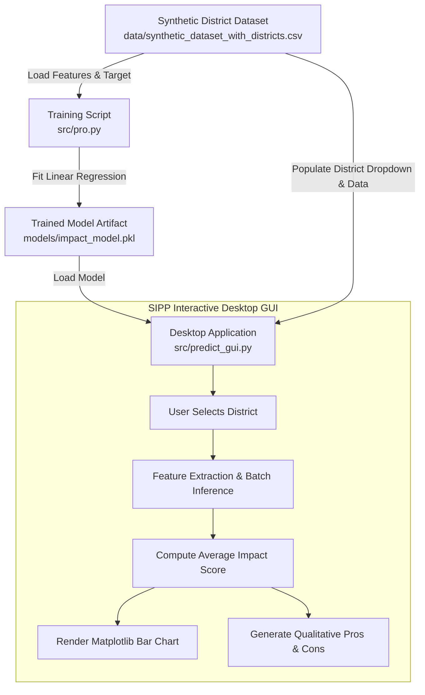

# SIPP - Social Impact Prediction Platform

[](https://www.python.org/)
[](https://scikit-learn.org/)
[](https://pandas.pydata.org/)
[](https://matplotlib.org/)
[](https://docs.python.org/3/library/tkinter.html)
[](LICENSE)

> **SIPP (Social Impact Prediction Platform)** is a machine learning-powered decision support system designed to estimate, analyze, and visualize the potential social impact of developmental, public welfare, and community initiatives across regional districts.

---

## Table of Contents

- [Overview](#overview)
- [Key Features](#key-features)
- [System Architecture](#system-architecture)
- [Dataset Specifications](#dataset-specifications)
- [Machine Learning Pipeline](#machine-learning-pipeline)
  - [Model Details](#model-details)
  - [Evaluation Metrics](#evaluation-metrics)
  - [Feature Coefficients](#feature-coefficients)
- [GUI & Decision Engine](#gui--decision-engine)
  - [Impact Score Breakdown](#impact-score-breakdown)
  - [Qualitative Decision Matrix](#qualitative-decision-matrix)
- [Project Structure](#project-structure)
- [Getting Started](#getting-started)
  - [Prerequisites](#prerequisites)
  - [Installation](#installation)
  - [Running the GUI Application](#running-the-gui-application)
  - [Retraining the Model](#retraining-the-model)
- [Roadmap & Enhancements](#roadmap--enhancements)
- [Contributing](#contributing)
- [Author & Acknowledgments](#author--acknowledgments)

---

## Overview

Governments, NGOs, CSR (Corporate Social Responsibility) committees, and municipal bodies frequently allocate significant capital toward public welfare and development projects. However, assessing which initiatives will yield the highest community return on investment before deployment remains a challenge.

**SIPP** bridges this gap by applying supervised machine learning to project attributes (such as budget size, target population reach, urban/rural zoning, and sustainability metrics). It provides:
1. **Quantitative Impact Forecasting:** An objective Impact Score (0–100 scale).
2. **Regional Granularity:** Aggregate predictions tailored across districts (e.g., Indore, Bhopal, Jabalpur, Rewa, Betul).
3. **Actionable Qualitative Feedback:** Automated analysis of project trade-offs (pros vs. cons) to support policy planning and resource allocation.

---

## Key Features

- **Predictive Impact Modeling:** Uses a trained multivariate Linear Regression model with an **$R^2$ score of ~0.926**, mapping project inputs directly to social outcomes.
- **Interactive Desktop GUI:** Built with Python's native `Tkinter` and `ttk` framework, featuring a responsive, user-friendly layout.
- **Embedded Visual Analytics:** Live Matplotlib canvas dynamically renders district impact metrics on a standardized 0–100 scale bar chart.
- **Automated Pros & Cons Evaluation:** Rule-based decision logic interprets numerical scores into clear strategic takeaways (sustainability, cost feasibility, and public interest).
- **Clean & Modular Pipeline:** Decoupled training pipeline (`src/pro.py`) and inference interface (`src/predict_gui.py`) with serialized model artifacts (`joblib`).

---

## System Architecture



---

## Dataset Specifications

The platform is trained on structured project records (`data/synthetic_dataset_with_districts.csv`) capturing key project parameters across administrative districts in central India:

| Column Name | Data Type | Description | Observed Range |
| :--- | :--- | :--- | :--- |
| **`District`** | `String` | Target administrative division (Indore, Jabalpur, Bhopal, Betul, Rewa) | 5 Districts |
| **`Budget`** | `Integer` | Allocated financial funding (in INR / local currency units) | ₹121,959 – ₹999,684 |
| **`Target_Audience`** | `Integer` | Estimated number of direct beneficiaries reached | 697 – 19,992 individuals |
| **`Location`** | `Integer` | Geographic / zoning tier index | 1 – 4 |
| **`Sustainability_Factors`** | `Integer` | Environmental and longevity score index | 1 – 9 |
| **`Impact_Score`** | `Float` | Target metric indicating overall project efficacy and social return | 8.01 – 94.84 (Mean: 50.78) |

### District Summary Statistics

| District | Sample Count | Avg. Budget | Avg. Target Reach | Avg. Impact Score |
| :--- | :---: | :---: | :---: | :---: |
| **Indore** | 26 | ₹589,779 | 11,420 | **57.08** |
| **Jabalpur** | 19 | ₹576,526 | 10,357 | **54.26** |
| **Rewa** | 18 | ₹567,915 | 9,882 | **51.69** |
| **Bhopal** | 16 | ₹489,287 | 8,591 | **44.74** |
| **Betul** | 21 | ₹444,640 | 10,122 | **43.67** |

---

## Machine Learning Pipeline

### Model Details
The underlying engine uses an **Ordinary Least Squares (OLS) Linear Regression** model implemented via `scikit-learn`:

$$\text{Impact Score} = \beta_0 + \beta_1(\text{Budget}) + \beta_2(\text{Target Audience}) + \beta_3(\text{Location}) + \beta_4(\text{Sustainability Factors})$$

```python
# Empirical Regression Formula:
Impact_Score = (
    -4.8591
    + (0.00005285 * Budget)
    + (0.00207220 * Target_Audience)
    - (0.76089057 * Location)
    + (1.75527913 * Sustainability_Factors)
)
```

### Evaluation Metrics

| Metric | Score | Interpretation |
| :--- | :---: | :--- |
| **Coefficient of Determination ($R^2$)** | **0.9258** | ~92.6% of the variance in social impact is explained by the input features. |
| **Mean Absolute Error (MAE)** | **4.15** | Average absolute error of ~4.15 points on a 0–100 scale. |
| **Root Mean Squared Error (RMSE)** | **5.15** | Low residual variance demonstrating high predictive stability. |

### Feature Coefficients

| Feature | Coefficient ($\beta$) | Impact on Score |
| :--- | :---: | :--- |
| **Sustainability Factors** | `+1.7553` | Highest positive unit-rate contribution; ecological soundness significantly boosts score. |
| **Target Audience** | `+0.0021` | Positive scaling; wider beneficiary reach steadily raises social impact. |
| **Budget** | `+0.000053` | Linear positive scaling with total capital deployed. |
| **Location** | `-0.7609` | Moderate negative weighting depending on zoning complexity / tier difficulty. |
| **Intercept ($\beta_0$)** | `-4.8591` | Baseline calibration intercept. |

---

## GUI & Decision Engine

The graphical interface (`src/predict_gui.py`) is styled with a modern, distraction-free neutral theme (`#f5f5f5`) and includes:

1. **District Selector:** Instant dropdown listing all unique districts present in the dataset.
2. **Prediction Trigger:** Instant batch inference across matching district projects to derive the mean expected impact.
3. **Visual Gauge:** An integrated Matplotlib chart displaying the resulting score on a clear 0–100 axis.
4. **Strategic Insights Panel:** Automated pros and cons categorizing recommendations based on the predicted score.

### Qualitative Decision Matrix

```
                      Impact Score (0 - 100)
       0                     40                     70                   100
       |----------------------|----------------------|----------------------|
            Low Impact            Moderate Impact          High Impact
         (Cost-effective       (Balanced benefits,       (High sustainability,
          short-term, low       moderate success,         strong economic &
          societal impact)      policy hurdles)           public benefits)
```

- **High Impact (> 70):**
  - **Pros:** High sustainability, good public acceptance, strong economic benefits.
  - **Cons:** High initial investment may be required.
- **Moderate Impact (40 to 70):**
  - **Pros:** Balanced benefits, moderate success expected.
  - **Cons:** Some sustainability concerns or policy hurdles may arise.
- **Low Impact (≤ 40):**
  - **Pros:** Cost-effective in the short term.
  - **Cons:** Low impact, sustainability, and public interest issues.

---

## Project Structure

```
SIPP_/
├── data/
│   └── synthetic_dataset_with_districts.csv  # 100-record dataset with district metrics
├── models/
│   └── impact_model.pkl                      # Serialized scikit-learn regression model
├── src/
│   ├── predict_gui.py                        # Tkinter GUI application with Matplotlib integration
│   └── pro.py                                # Model training and serialization script
├── .gitattributes                            # Git line-ending configuration
├── requirements.txt                          # Python package dependencies
└── README.md                                 # Project documentation
```

---

## Getting Started

### Prerequisites

Ensure you have **Python 3.8 or later** installed. Verify your installation with:

```bash
python --version
```

### Installation

1. **Clone the repository:**
   ```bash
   git clone https://github.com/VaishnavSreekumar/SIPP_.git
   cd SIPP_
   ```

2. **Create and activate a virtual environment (recommended):**
   - **Windows:**
     ```bash
     python -m venv venv
     venv\Scripts\activate
     ```
   - **Linux / macOS:**
     ```bash
     python3 -m venv venv
     source venv/bin/activate
     ```

3. **Install dependencies:**
   ```bash
   pip install -r requirements.txt
   ```

### Running the GUI Application

Launch the desktop interface with:

```bash
python src/predict_gui.py
```

*Select a district from the dropdown (e.g., Indore, Bhopal, Betul) and click **"Predict Impact"** to view the score, chart, and qualitative assessment.*

### Retraining the Model

To retrain the linear regression model on new or updated data:

```bash
python src/pro.py
```

Upon completion, the updated model will be saved to `models/impact_model.pkl`.

---

## Roadmap & Enhancements

- [ ] **Web Application:** Port the Tkinter interface to a modern web application using **Streamlit** or **FastAPI + React/Next.js**.
- [ ] **Advanced ML Algorithms:** Benchmark against ensemble methods (**Random Forest Regressor**, **Gradient Boosting**, **XGBoost**) and hyperparameter tuning.
- [ ] **Interactive GIS Mapping:** Integrate geographical shapefiles with **Folium** or **GeoPandas** to visualize district heatmaps across state boundaries.
- [ ] **Custom Scenario Simulator:** Allow users to input custom budget, target audience, and sustainability parameters instead of relying solely on existing district records.
- [ ] **Exportable Reports:** Add automated PDF/Excel summary report generation for stakeholder presentations.

---

## Contributing

Contributions, issues, and feature requests are welcome!

1. Fork the Project
2. Create your Feature Branch (`git checkout -b feature/AmazingFeature`)
3. Commit your Changes (`git commit -m "Add some AmazingFeature"`)
4. Push to the Branch (`git push origin feature/AmazingFeature`)
5. Open a Pull Request

---

## Author & Acknowledgments

- **Author:** [Vaishnav Sreekumar](https://github.com/VaishnavSreekumar)
- **Repository:** [VaishnavSreekumar/SIPP_](https://github.com/VaishnavSreekumar/SIPP_)

---

<p align="center">
  <i>Developed for data-driven social impact evaluation and sustainable public policy planning.</i>
</p>
